<h1 align="center">Αριθμομηχανή και φόρμα στοιχείων</h1>

<p align="center">
  Δύο εφαρμογές παραθύρου σε Python με Tkinter: αριθμομηχανή δύο αριθμών και φόρμα καταχώρισης στοιχείων.<br>
  Δημιουργός: <strong>TSOUTAS KONSTANTINOS</strong>
</p>

Η εργασία αποτελείται από δύο ανεξάρτητα προγράμματα. Το πρώτο είναι αριθμομηχανή: ο χρήστης γράφει δύο αριθμούς και πατάει ένα από τα κουμπιά πρόσθεσης, αφαίρεσης, πολλαπλασιασμού, διαίρεσης, υπολοίπου, ακέραιου πηλίκου και δύναμης. Το δεύτερο είναι φόρμα στοιχείων: όνομα, ηλικία και email. Το κουμπί OK ανοίγει μήνυμα και έπειτα τυπώνει τα ίδια στοιχεία μέσα στο παράθυρο. Η ακύρωση καθαρίζει τη φόρμα και το Close την κλείνει.

Κάθε πρόγραμμα είναι ένα αρχείο `Main.py` και ανοίγει το δικό του παράθυρο. Δεν μοιράζονται δεδομένα και δεν γράφουν τίποτα σε αρχείο.

## Περιεχόμενα

1. [Αριθμομηχανή](#αριθμομηχανή)
2. [Φόρμα στοιχείων](#φόρμα-στοιχείων)
3. [Εκτέλεση](#εκτέλεση)
4. [Αρχεία](#αρχεία)
5. [Παράδειγμα αριθμομηχανής](#παράδειγμα-αριθμομηχανής)
6. [Παράδειγμα φόρμας](#παράδειγμα-φόρμας)
7. [Συναρτήσεις](#συναρτήσεις)
8. [Άδεια χρήσης και πνευματικά δικαιώματα](#άδεια-χρήσης--πνευματικά-δικαιώματα-license)

## Αριθμομηχανή

Το παράθυρο έχει τίτλο `calculator` και μέγεθος `300x400`. Πάνω είναι ο τίτλος, μετά δύο πεδία και μετά τα κουμπιά. Το αποτέλεσμα γράφεται σε κίτρινη ετικέτα κάτω από τα κουμπιά.

| Κουμπί | Πράξη | Συνάρτηση |
| --- | --- | --- |
| `+` | Πρόσθεση | `Addition` |
| `-` | Αφαίρεση | `Substraction` |
| `*` | Πολλαπλασιασμός | `Multiply` |
| `/` | Διαίρεση | `Division` |
| `mod` | Υπόλοιπο | `Mod` |
| `div` | Ακέραιο πηλίκο | `Div` |
| `pow` | Δύναμη | `Pow` |

Κάθε συνάρτηση διαβάζει τα δύο πεδία με `float`, κάνει την πράξη και στρογγυλοποιεί το αποτέλεσμα σε δύο δεκαδικά με `round`. Η ετικέτα δείχνει και τους δύο αριθμούς και το αποτέλεσμα, για παράδειγμα ` 8.0 + 3.0 = 11.0`. Το κενό στην αρχή και το `.0` προέρχονται από τον τρόπο που σχηματίζεται το κείμενο: οι τιμές είναι `float`.

Οι `Division`, `Mod` και `Div` έχουν `try` / `except`. Αν η πράξη αποτύχει, η ετικέτα γίνεται `oxi diairesi me 0` αντί να σταματήσει το πρόγραμμα. Αυτό συμβαίνει στη διαίρεση με το μηδέν. Οι υπόλοιπες τέσσερις πράξεις δεν έχουν `try`. Αν σε εκείνες γραφτεί κείμενο αντί για αριθμό, το πρόγραμμα σταματά με σφάλμα μετατροπής.

Η `Div` χρησιμοποιεί `//`, άρα κρατά το ακέραιο πηλίκο, και μετά το στρογγυλοποιεί. Η `Mod` χρησιμοποιεί `%`. Η `Pow` καλεί την `pow`.

## Φόρμα στοιχείων

Η φόρμα έχει τίτλο `Στοιχεία Χρήστη` και τρία πεδία: `Όνομα`, `Ηλικία`, `Email`. Ο τίτλος της γραμμής του παραθύρου μένει `tk`, γιατί ο κώδικας δεν καλεί `title`.

| Κουμπί | Τι γίνεται | Συνάρτηση |
| --- | --- | --- |
| OK | Ανοίγει μήνυμα και μετά γράφει τα στοιχεία στην ετικέτα | `Alert`, έπειτα `Ok` |
| Ακύρωση | Σβήνει τα τρία πεδία και την ετικέτα | `Cancel` |
| Close | Κλείνει το παράθυρο | `Close` |

Το μήνυμα και η ετικέτα αποτελέσματος έχουν τρεις γραμμές: όνομα, ηλικία, email. Η λέξη της ηλικίας σε αυτό το κείμενο είναι `Ηληκία`, όπως είναι γραμμένη μέσα στις `Alert` και `Ok`. Η ετικέτα δίπλα στο πεδίο γράφει `Ηλικία`.

Η ετικέτα αποτελέσματος έχει φόντο `#2E2E2E` και γράμματα `#9F0000`. Το μήνυμα είναι το παράθυρο του `messagebox.showinfo`, με τίτλο `Στοιχεία` και κουμπί OK.

## Εκτέλεση

Χρειάζεται Python 3. Η `tkinter` είναι μέσα στην τυπική βιβλιοθήκη. Οι εντολές δίνονται μέσα στον φάκελο `Semester_Project`.

```bash
python3 1_Calculator/Main.py
```

```bash
python3 2_ContactForm/Main.py
```

Κάθε εντολή ανοίγει ένα παράθυρο και μένει εκεί μέχρι να κλείσει. Στην αριθμομηχανή το `root.mainloop()` κρατάει το πρόγραμμα ανοιχτό. Η γραμμή `buttonsFrame.mainloop()` που ακολουθεί δεν προλαβαίνει να τρέξει.

## Παράδειγμα αριθμομηχανής

Στο παράδειγμα γράφονται οι αριθμοί `8` και `3`. Μετά αλλάζει ο δεύτερος σε `0`, για τη διαίρεση με το μηδέν.

### 1. Εκκίνηση

Ανοίγει το παράθυρο. Τα πεδία είναι άδεια και η κίτρινη ετικέτα δεν έχει κείμενο.

<p align="center">
  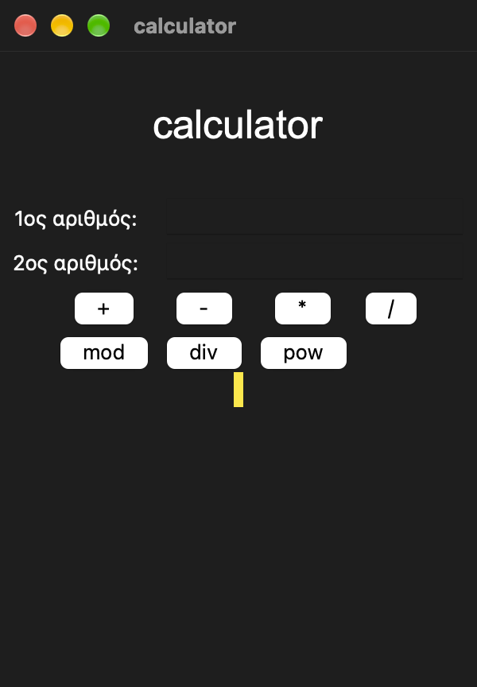
</p>

### 2. Εισαγωγή των δύο αριθμών

Ο χρήστης γράφει `8` στο πεδίο `1ος αριθμός` και `3` στο πεδίο `2ος αριθμός`. Δεν έχει πατηθεί ακόμη κουμπί πράξης.

<p align="center">
  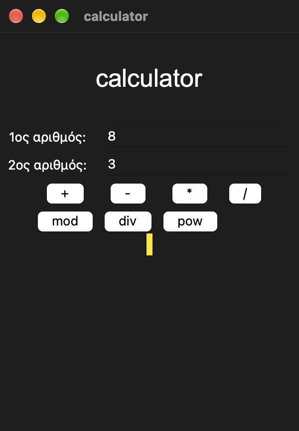
</p>

### 3. Πρόσθεση

Το `+` καλεί την `Addition`. Η ετικέτα γίνεται ` 8.0 + 3.0 = 11.0`.

<p align="center">
  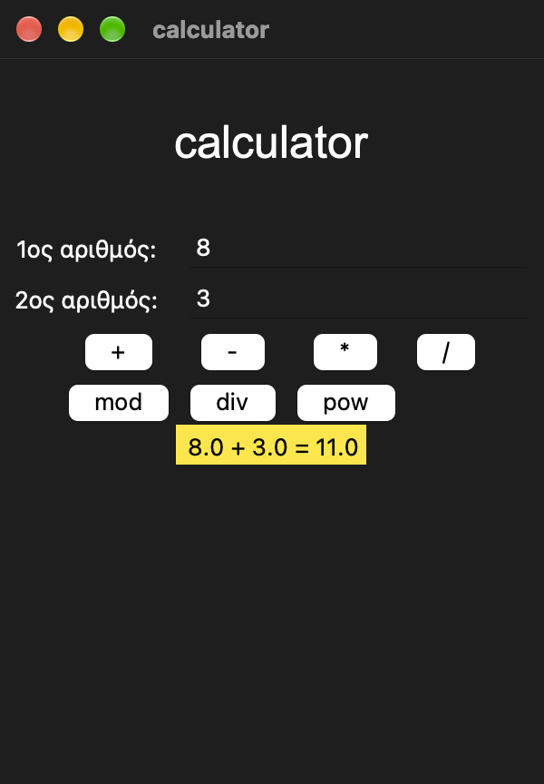
</p>

### 4. Αφαίρεση

Το `-` καλεί την `Substraction`. Η ετικέτα γίνεται ` 8.0 - 3.0 = 5.0`.

<p align="center">
  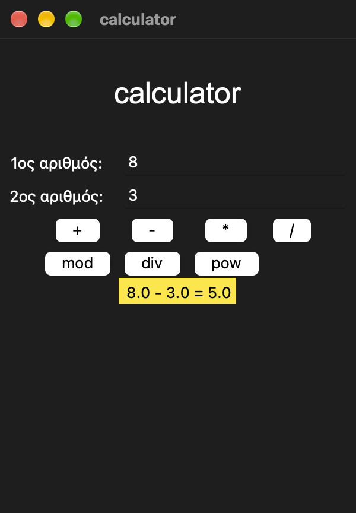
</p>

### 5. Πολλαπλασιασμός

Το `*` καλεί την `Multiply`. Η ετικέτα γίνεται ` 8.0 * 3.0 = 24.0`.

<p align="center">
  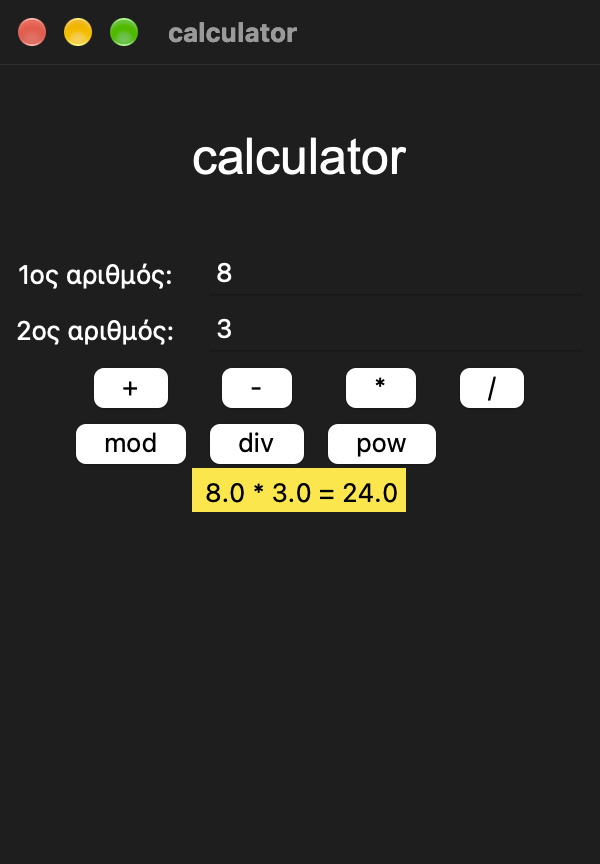
</p>

### 6. Διαίρεση

Το `/` καλεί την `Division`. Η ετικέτα γίνεται ` 8.0 / 3.0 = 2.67`.

<p align="center">
  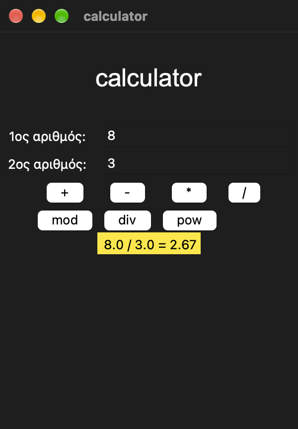
</p>

### 7. Υπόλοιπο

Το `mod` καλεί την `Mod`. Η ετικέτα γίνεται ` 8.0 mod 3.0 = 2.0`.

<p align="center">
  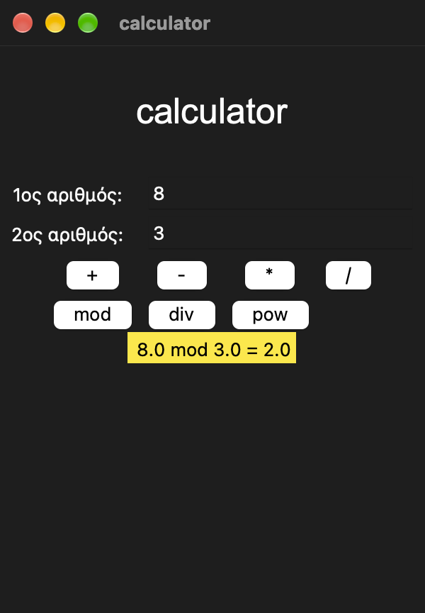
</p>

### 8. Ακέραιο πηλίκο

Το `div` καλεί την `Div`. Η διαίρεση `//` δίνει `2` και η ετικέτα γίνεται ` 8.0 div 3.0 = 2.0`.

<p align="center">
  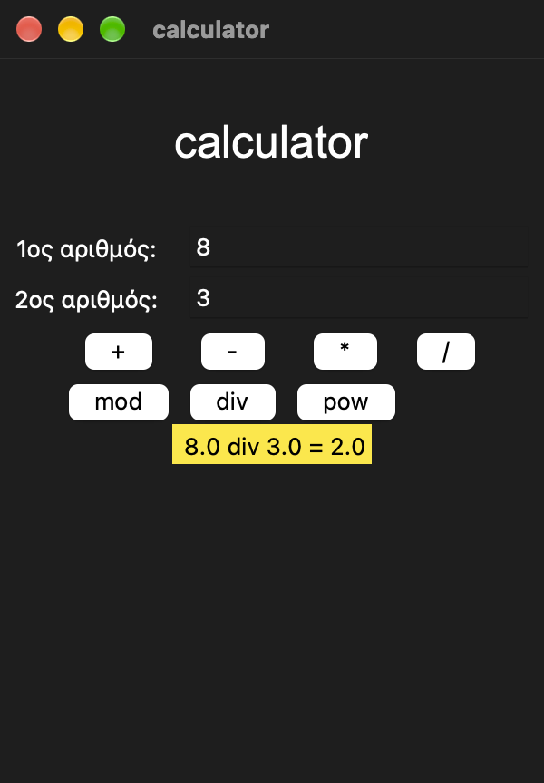
</p>

### 9. Δύναμη

Το `pow` καλεί την `Pow`. Η ετικέτα γίνεται ` 8.0 ^ 3.0 = 512.0`.

<p align="center">
  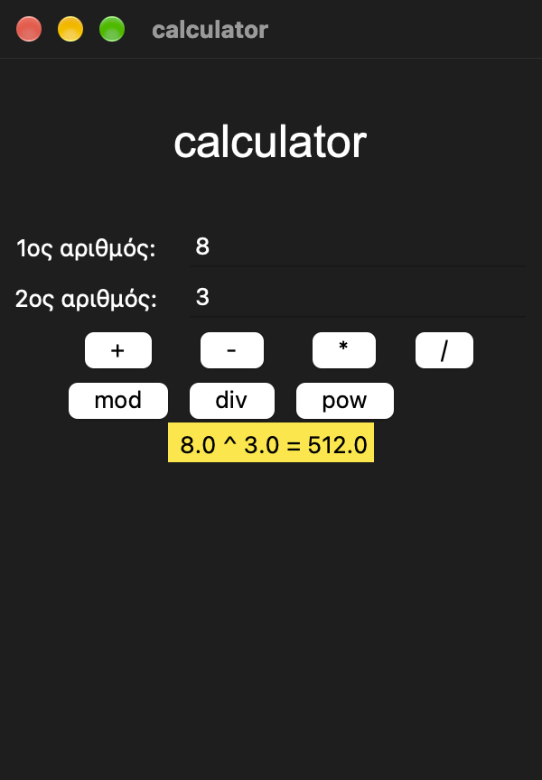
</p>

### 10. Διαίρεση με το μηδέν

Ο δεύτερος αριθμός αλλάζει σε `0` και πατιέται το `/`. Η `Division` πιάνει το σφάλμα και η ετικέτα γίνεται `oxi diairesi me 0`. Το ίδιο κείμενο δίνουν και τα `mod` και `div` όταν ο διαιρέτης είναι μηδέν.

<p align="center">
  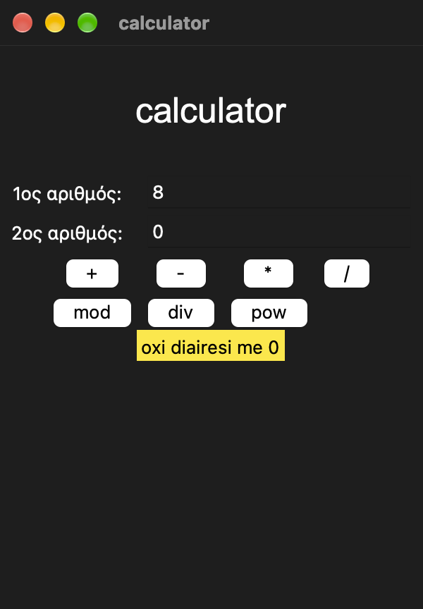
</p>

## Παράδειγμα φόρμας

Στο παράδειγμα γράφονται το όνομα `Κωνσταντίνος Τσούτας`, ηλικία `21` και email `ktsoutas@example.com`.

### 1. Κενή φόρμα

Τα τρία πεδία είναι άδεια. Η ετικέτα κάτω από τα κουμπιά δεν έχει κείμενο.

<p align="center">
  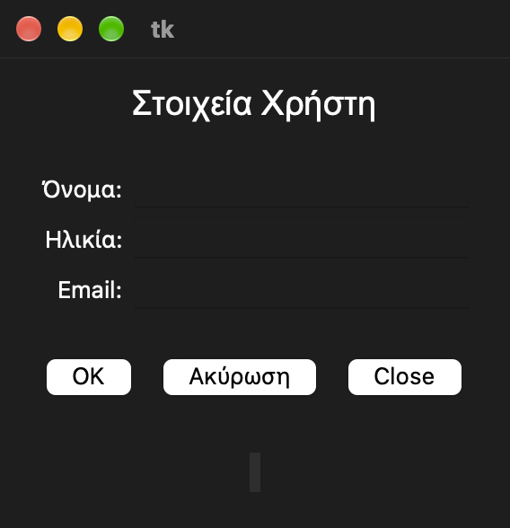
</p>

### 2. Συμπλήρωση

Ο χρήστης γεμίζει όνομα, ηλικία και email. Δεν έχει πατηθεί ακόμη το OK.

<p align="center">
  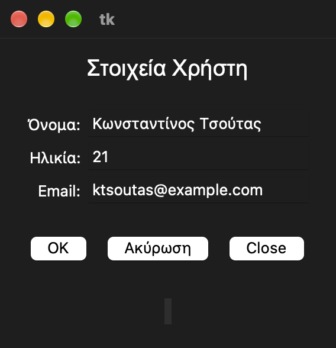
</p>

### 3. Μήνυμα

Το OK καλεί την `Alert`. Εκείνη ανοίγει το `messagebox.showinfo` με τίτλο `Στοιχεία` και τις τρεις γραμμές. Το παράθυρο κλείνει με το OK του μηνύματος.

<p align="center">
  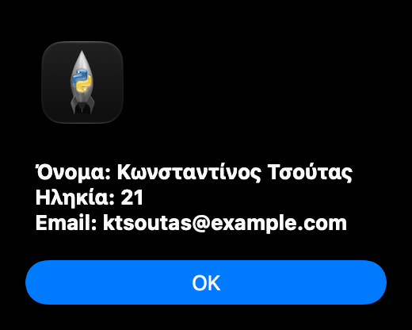
</p>

### 4. Εμφάνιση στη φόρμα

Μόλις κλείσει το μήνυμα, η `Alert` καλεί την `Ok`. Η `Ok` γράφει τις ίδιες τρεις γραμμές στην ετικέτα κάτω από τα κουμπιά.

<p align="center">
  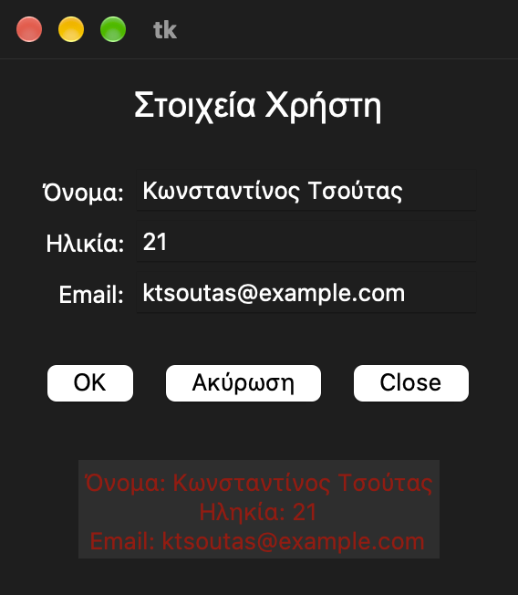
</p>

### 5. Ακύρωση

Η `Cancel` σβήνει και τα τρία πεδία, από τη θέση `0` ως το τέλος, και αδειάζει την ετικέτα. Η φόρμα ξαναγίνεται όπως στην αρχή.

<p align="center">
  
</p>

### 6. Κλείσιμο

Το Close καλεί την `Close`, και εκείνη την `root.destroy()`. Το παράθυρο κλείνει και το πρόγραμμα τελειώνει.

## Συναρτήσεις

### Αριθμομηχανή

| Συνάρτηση | Ενέργειες |
| --- | --- |
| `Addition` | Διαβάζει τους δύο αριθμούς, τους προσθέτει, στρογγυλοποιεί σε δύο δεκαδικά και γράφει την ετικέτα. |
| `Substraction` | Αφαιρεί τον δεύτερο από τον πρώτο και γράφει την ετικέτα. |
| `Multiply` | Πολλαπλασιάζει τους δύο αριθμούς και γράφει την ετικέτα. |
| `Division` | Διαιρεί. Αν η πράξη αποτύχει, γράφει `oxi diairesi me 0`. |
| `Mod` | Υπολογίζει το υπόλοιπο με `%`. Στο μηδέν δείχνει το ίδιο μήνυμα. |
| `Div` | Υπολογίζει το ακέραιο πηλίκο με `//`. Στο μηδέν δείχνει το ίδιο μήνυμα. |
| `Pow` | Υψώνει τον πρώτο αριθμό στη δύναμη του δεύτερου με την `pow`. |

Τα πεδία είναι τα `num1` και `num2`. Η ετικέτα του αποτελέσματος είναι το `result`. Το κείμενο αλλάζει με `result['text']`.

### Φόρμα στοιχείων

| Συνάρτηση | Ενέργειες |
| --- | --- |
| `Alert` | Ανοίγει το μήνυμα με όνομα, ηλικία και email. Όταν ο χρήστης πατήσει OK, καλεί την `Ok`. |
| `Ok` | Γράφει τις τρεις γραμμές στην `resultLabel`. |
| `Cancel` | Σβήνει τα `name`, `age` και `email` και αδειάζει την ετικέτα. |
| `Close` | Καλεί την `root.destroy()` και κλείνει το παράθυρο. |

## Άδεια Χρήσης & Πνευματικά Δικαιώματα (License)

Copyright © 2026 Κωνσταντίνος Τσούτας (`KostasTsoutas`). Με επιφύλαξη παντός νομίμου δικαιώματος.

Το παρόν έργο εκπονήθηκε στο πλαίσιο εξαμηνιαίας εργασίας.  
Διατίθεται υπό τους όρους της άδειας ελεύθερου λογισμικού **GNU General Public License v3.0 (GPL-3.0)** δείτε το αρχείο [LICENSE](LICENSE) για τις πλήρεις λεπτομέρειες.

## License & Copyright

Copyright © 2026 Kostas Tsoutas (`KostasTsoutas`). All rights reserved.

This project was developed as a semester assignment.  
It is licensed under the **GNU General Public License v3.0 (GPL-3.0)** see the [LICENSE](LICENSE) file for details.
